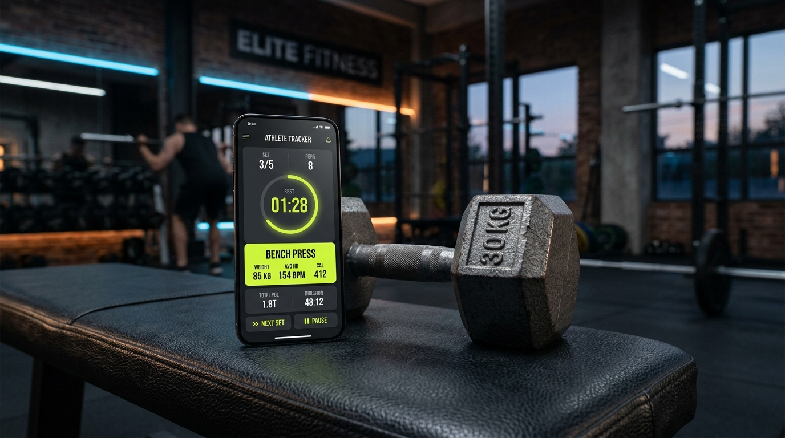
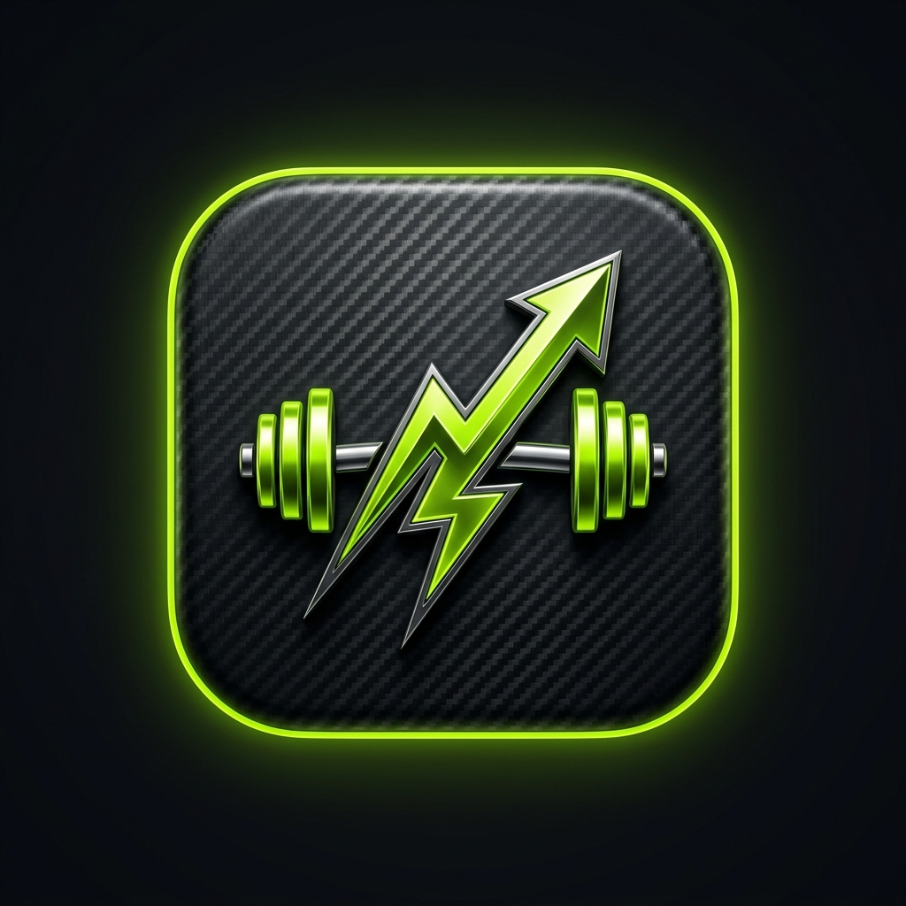

<div align="center">

  

  # ⚡ MiProgreso Gym
  
  **Tu rutina, tus pesos, tu evolución diaria. Sin suscripciones, sin anuncios y 100% offline.**

  [](https://reactnative.dev/)
  [](https://expo.dev/)
  [](https://www.typescriptlang.org/)
  [](https://docs.expo.dev/versions/latest/sdk/sqlite/)
  [](LICENSE)

  <p align="center">
    <a href="#-características">Características</a> •
    <a href="#-por-qué-miprogreso-gym">Por qué esta app</a> •
    <a href="#-interfaz-y-diseño">Diseño</a> •
    <a href="#-stack-tecnológico">Stack</a> •
    <a href="#-instalación-y-uso">Instalación</a> •
    <a href="#-roadmap">Roadmap</a>
  </p>
</div>

---

## 💡 ¿Por qué MiProgreso Gym?

La mayoría de las apps de entrenamiento en las tiendas actuales sufren de lo mismo: suscripciones mensuales abusivas, muros de pago para ver tus propios datos, publicidad molesta entre series y dependencia de servidores en la nube que fallan cuando no hay buena señal en el gimnasio.

**MiProgreso Gym** nace con una premisa clara:
- 📱 **100% Offline-First:** Tus rutinas y marcas viven en la base de datos local SQLite de tu dispositivo. Jamás te vas a quedar sin poder anotar por mala señal.
- 💸 **Totalmente Gratis:** Sin membresías "Pro", sin microtransacciones y sin anuncios invasivos.
- ⚡ **Ágil e intuitiva:** Diseñada con botones amplios y tipografía de alto contraste en tema *Lima Eléctrica*, pensada para usarse con sudor y una sola mano entre series.
- 🔒 **Tus datos son tuyos:** Exportación e importación de backups en JSON en cualquier momento.

---

## ✨ Características Principales

### 🏠 Pantalla "Hoy"
- **Mini semana activa:** Visualizador de Lunes a Domingo que marca con un check (`✓`) los días que fuiste al gimnasio.
- **Meta semanal configurable:** Seguimiento visual de tu objetivo semanal (ej: `2/3 entrenamientos`).
- **Días desde el último entrenamiento:** Contador motivacional para sostener la constancia.
- **Rutina sugerida y selector rápido:** Propone la rutina del día o te permite cambiarla al instante mediante un menú desplegable inferior (*Bottom Sheet*).
- **Consejo diario de salud y descanso:** Más de 20 recomendaciones basadas en evidencia sobre descanso, nutrición e hidratación.

### ⚡ Entrenamiento Activo
- **Cronómetro continuo:** Duración exacta de la sesión en tiempo real.
- **Sobrecarga progresiva ("La última vez"):** Muestra en gris tenue los kilos y repeticiones de la sesión anterior (`70 kg × 8`) para que siempre sepas qué peso superar.
- **Feedback táctil háptico:** Botón de completado amplio (`✓`) que responde con vibración de confirmación al terminar cada serie.
- **Series de calentamiento:** Marcador diferenciado (`C`) para no distorsionar tus cálculos de fuerza ni 1RM.
- **Temporizador de descanso automático:** Cuenta regresiva que arranca sola al completar cada serie, con controles rápidos (`+15s`, `-15s`, saltar) y avisos sonoros/vibratorios al finalizar.
- **Flexibilidad en vivo:** Agregá o quitá series, o sumá nuevos ejercicios desde la biblioteca sobre la marcha si una máquina está ocupada.
- **Resumen al terminar:** Cálculo instantáneo de kilos totales levantados (`volumen = peso × reps`) y tiempo total.

### 📋 Gestión de Rutinas
- Creación de rutinas ilimitadas (ej. *Pecho y Bíceps*, *Piernas*, *Push / Pull / Legs*).
- Asignación flexible de días sugeridos de la semana.
- Personalización por ejercicio: series objetivo, repeticiones/tiempo y segundos de descanso.
- Reordenamiento rápido de ejercicios con controles ↑ / ↓.

### 📚 Biblioteca de Ejercicios
- Más de 30 ejercicios precargados divididos por grupo muscular (*Pecho, Espalda, Piernas, Hombros, Bíceps, Tríceps, Core, Calentamiento y Elongación*).
- Soporte para ejercicios de **fuerza** (`kg × reps`) y por **tiempo** (`segundos`).
- Creación y gestión de ejercicios personalizados.

---

## 🎨 Interfaz y Diseño

<div align="center">
  
  <p><em>Ícono oficial de la aplicación (formato squircle en titanio y lima eléctrica)</em></p>
</div>

Construida con la paleta deportiva de alto contraste **Lima Eléctrica**:
- **Fondo:** Grafito profundo (`#121417`) para descanso visual en interiores.
- **Superficies:** Tarjetas elevadas (`#1C1F24` / `#24282E`) con bordes redondeados ergonómicos.
- **Acento:** Verde Lima neón (`#C6F432`) para destacar estados activos, cronómetros y botones principales.
- **Tipografía:** *Inter* para textos y lectura clara; *Space Grotesk* para dígitos y cronómetros numéricos.

---

## 🛠️ Stack Tecnológico

| Capa | Tecnología | Propósito |
|---|---|---|
| **Framework** | [React Native](https://reactnative.dev/) / [Expo SDK 57](https://expo.dev/) | Desarrollo nativo multiplataforma (Android & iOS) |
| **Arquitectura** | [Expo Router](https://docs.expo.dev/router/introduction/) | Navegación nativa basada en sistema de archivos |
| **Base de Datos** | [expo-sqlite](https://docs.expo.dev/versions/latest/sdk/sqlite/) | Almacenamiento relacional local offline |
| **Estado Global** | [Zustand](https://github.com/pmndrs/zustand) | Manejo de sesión activa, cronómetro y temporizadores |
| **Háptica y Avisos** | [expo-haptics](https://docs.expo.dev/versions/latest/sdk/haptics/) + notifications | Vibraciones y alertas de descanso |
| **Tipografía** | [expo-google-fonts](https://github.com/expo/google-fonts) | Fuentes Inter & Space Grotesk |

---

## 🚀 Instalación y Uso Local

### Requisitos previos
- Node.js (v18 o superior)
- App **Expo Go** instalada en tu dispositivo móvil ([Android](https://play.google.com/store/apps/details?id=host.exp.exponent) / [iOS](https://apps.apple.com/app/expo-go/id982107779))

### Pasos

1. **Clonar el repositorio:**
   ```bash
   git clone https://github.com/IgnacioHM112/miprogreso-gym.git
   cd miprogreso-gym
   ```

2. **Instalar dependencias:**
   ```bash
   npm install
   ```

3. **Iniciar el servidor de desarrollo:**
   ```bash
   npx expo start
   ```

4. **Ejecutar en tu celular:**
   - Abrí la app **Expo Go** y escaneá el código QR que figura en la consola.

---

## 🗺️ Roadmap del Proyecto

- [x] **Fase 0:** Setup del entorno, base de datos SQLite y seed inicial de ejercicios.
- [x] **Fase 1:** Sistema de diseño Lima Eléctrica, pantalla Hoy, CRUD de rutinas ilimitadas y biblioteca con buscador y filtros.
- [x] **Fase 2:** Entrenamiento activo interactivo, cronómetro, "última vez", selector táctil de discos/reps sin teclado, timer de descanso automático con hápticos y guardado de sesiones.
- [x] **Fase 3:** Calendario mensual integrado, historial de sesiones, gráficos de progresión, récords personales (PR) y cálculo de 1RM estimado (fórmula Epley).
- [ ] **Fase 4:** Registro de peso corporal con evolución temporal, recordatorios locales configurables y exportación/importación de backup (JSON).
- [ ] **Fase 5:** Pulido estético final, launcher icon nativo y generación de APK instalable independiente mediante EAS Build.

---

## 📄 Licencia

Distribuido bajo la Licencia MIT. Consulta el archivo `LICENSE` para más detalles.
